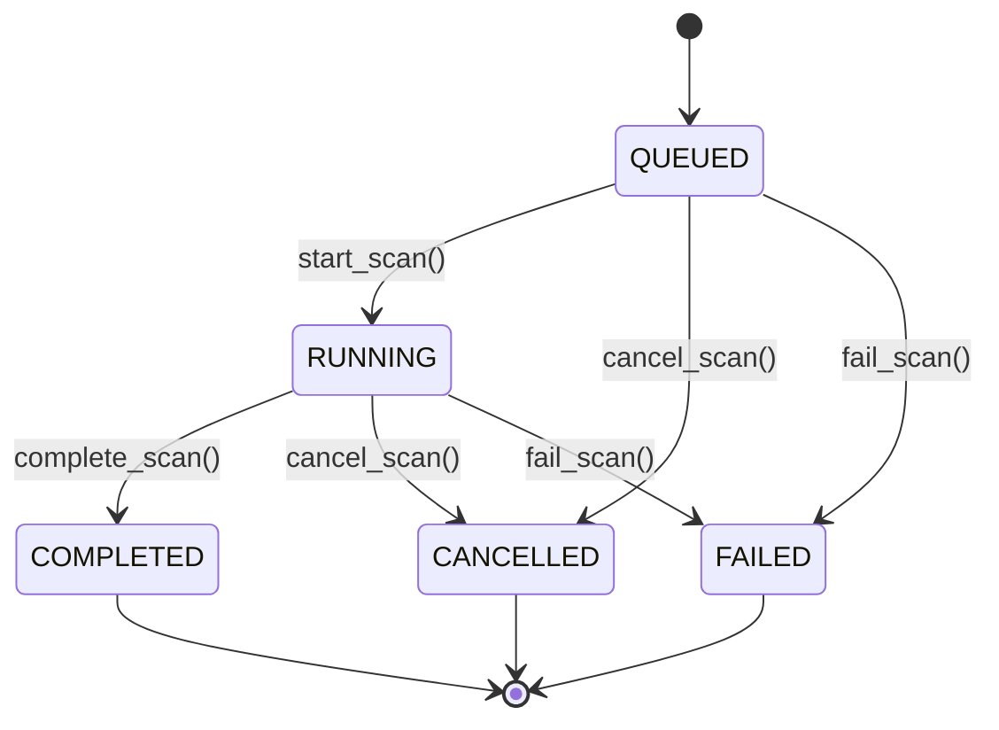

# SCAN ARCHITECTURE

## Overview

The ShadowOps scanning system implements a controlled, authorization-gated scanning pipeline that transforms user-initiated scan requests into executed static analysis with persisted findings.

## Architecture Diagram

```
┌─────────────────────────────────────────────────────────────────────────┐
│                        FRONTEND (Next.js)                               │
│  ┌─────────────┐  ┌─────────────┐  ┌─────────────┐  ┌─────────────┐   │
│  │  Assets     │  │   Scans     │  │  Scan       │  │  Findings   │   │
│  │  Page       │  │  Page       │  │  Detail     │  │  View       │   │
│  └──────┬──────┘  └──────┬──────┘  └──────┬──────┘  └──────┬──────┘   │
└─────────┼────────────────┼────────────────┼────────────────┼──────────┘
          │                │                │                │
          ▼                ▼                ▼                ▼
┌─────────────────────────────────────────────────────────────────────────┐
│                      API GATEWAY (FastAPI)                              │
│  ┌─────────────┐  ┌─────────────┐  ┌─────────────┐  ┌─────────────┐   │
│  │ POST        │  │ GET         │  │ GET         │  │ GET         │   │
│  │ /scans      │  │ /scans      │  │ /scans/{id} │  │ /scans/{id}/│   │
│  │             │  │             │  │             │  │ events      │   │
│  └──────┬──────┘  └──────┬──────┘  └──────┬──────┘  └──────┬──────┘   │
└─────────┼────────────────┼────────────────┼────────────────┼──────────┘
          │                │                │                │
          ▼                ▼                ▼                ▼
┌─────────────────────────────────────────────────────────────────────────┐
│                     AUTHORIZATION LAYER                                 │
│  ┌─────────────────────────────────────────────────────────────────┐   │
│  │ require_scan_authorization(asset_id)                           │   │
│  │   1. Verify asset exists & belongs to workspace                │   │
│  │   2. Verify authorization record exists                        │   │
│  │   3. Verify status == VERIFIED                                 │   │
│  │   4. Verify not expired                                        │   │
│  │   5. Verify user workspace membership                          │   │
│  │   6. Audit log (allowed or blocked)                            │   │
│  └─────────────────────────────────────────────────────────────────┘   │
└─────────────────────────────────────────────────────────────────────────┘
          │
          ▼
┌─────────────────────────────────────────────────────────────────────────┐
│                       SCAN SERVICE                                      │
│  ┌─────────────────────────────────────────────────────────────────┐   │
│  │ ScanService                                                     │   │
│  │   create_scan()      → validates auth, creates QUEUED scan     │   │
│  │   start_scan()       → QUEUED → RUNNING, emits event           │   │
│  │   execute_scan()     → delegates to ScanJobRunner              │   │
│  │   complete_scan()    → RUNNING → COMPLETED, persists summary   │   │
│  │   fail_scan()        → RUNNING/QUEUED → FAILED                 │   │
│  │   cancel_scan()      → QUEUED/RUNNING → CANCELLED              │   │
│  │   get_scan_events()  → lifecycle events                        │   │
│  └─────────────────────────────────────────────────────────────────┘   │
└─────────────────────────────────────────────────────────────────────────┘
          │
          ▼
┌─────────────────────────────────────────────────────────────────────────┐
│                      SCAN JOB RUNNER                                    │
│  ┌─────────────────────────────────────────────────────────────────┐   │
│  │ ScanJobRunner                                                   │   │
│  │   1. validate_scan_ready()    → re-verify auth, asset, ws      │   │
│  │   2. _prepare_scan_target()   → resolve target path            │   │
│  │   3. _run_semgrep()           → execute Semgrep (SAST + SCA)   │   │
│  │   4. _persist_findings()      → normalize & store findings     │   │
│  │   5. _generate_summary()      → count by severity             │   │
│  │   6. _complete_scan()         → COMPLETED + audit log         │   │
│  │   Failure handling → FAILED + audit log                       │   │
│  │   Cancellation → CANCELLED + audit log                        │   │
│  └─────────────────────────────────────────────────────────────────┘   │
└─────────────────────────────────────────────────────────────────────────┘
          │
          ▼
┌─────────────────────────────────────────────────────────────────────────┐
│                       SEMGREP ADAPTER                                   │
│  ┌─────────────────────────────────────────────────────────────────┐   │
│  │ SemgrepManager                                                  │   │
│  │   SemgrepRunner                                                 │   │
│  │     scan(path) → SemgrepOutput (JSON)                         │   │
│  │     _build_command() → secure argument array                  │   │
│  │     timeout handling                                          │   │
│  │   FindingNormalizer                                            │   │
│  │     normalize() → List[NormalizedFinding]                     │   │
│  │     severity mapping (ERROR→critical, WARNING→high, INFO→med) │   │
│  │     CWE/CVE/OWASP extraction                                   │   │
│  │     deduplication                                             │   │
│  └─────────────────────────────────────────────────────────────────┘   │
└─────────────────────────────────────────────────────────────────────────┘
          │
          ▼
┌─────────────────────────────────────────────────────────────────────────┐
│                      DATABASE (Supabase PostgreSQL)                     │
│  ┌─────────────┐  ┌─────────────┐  ┌─────────────┐  ┌─────────────┐   │
│  │ scans       │  │ scan_events │  │ findings    │  │ finding_    │   │
│  │             │  │             │  │             │  │ evidence    │   │
│  │ RLS: ws_id  │  │ RLS: ws_id  │  │ RLS: ws_id  │  │ RLS: ws_id  │   │
│  └─────────────┘  └─────────────┘  └─────────────┘  └─────────────┘   │
└─────────────────────────────────────────────────────────────────────────┘
```

## Data Flow

### Scan Creation Flow

```
User clicks "Start Scan"
       │
       ▼
POST /scans {asset_id, scan_profile}
       │
       ▼
require_workspace_member (validates workspace access)
       │
       ▼
ScanService.create_scan()
       │
       ├─► Validate asset exists in workspace
       ├─► Validate authorization (NO AUTH → NO SCAN)
       ├─► Create scan record (QUEUED)
       ├─► Emit SCAN_CREATED event
       ├─► Emit AUTHORIZATION_CONFIRMED event
       ├─► Emit SCAN_QUEUED event
       └─► Audit log: scan.requested
       │
       ▼
Return scan_id to frontend
```

### Scan Execution Flow (Background)

```
Scan QUEUED
     │
     ▼
ScanJobRunner.execute_scan(scan_id)
     │
     ├─► _validate_scan_ready()
     │     ├─► Scan exists & RUNNING
     │     ├─► Asset exists & accessible
     │     └─► Authorization STILL valid (re-check!)
     │
     ├─► _prepare_scan_target()
     │     └─► Resolve path, validate within workspace
     │
     ├─► _run_semgrep()
     │     ├─► Build secure command array
     │     ├─► Execute with timeout
     │     └─► Parse JSON output
     │
     ├─► FindingNormalizer.normalize()
     │     ├─► Map Semgrep severities
     │     ├─► Extract CWE/CVE/OWASP
     │     └─► Deduplicate
     │
     ├─► _persist_findings()
     │     ├─► Create Finding records
     │     └─► Create FindingEvidence records
     │
     ├─► _generate_summary()
     │     └─► Count by severity
     │
     └─► _complete_scan()
           ├─► Update scan status COMPLETED
           ├─► Emit SCAN_COMPLETED event
           └─► Audit log: scan.completed
```

### Scan Cancellation Flow

```
User clicks "Cancel"
     │
     ▼
POST /scans/{id}/cancel
     │
     ▼
ScanService.cancel_scan()
     │
     ├─► Verify user = requester OR admin/owner
     ├─► Verify status in [QUEUED, RUNNING]
     ├─► Update status = CANCELLED
     ├─► Emit SCAN_CANCELLED event
     └─► Audit log: scan.cancelled
```

## State Machine

### Valid Transitions



### Invalid Transitions (Rejected)

- COMPLETED → RUNNING/QUEUED
- FAILED → RUNNING/QUEUED
- CANCELLED → RUNNING/QUEUED
- Any → QUEUED (only initial state)

## Database Schema

### scans Table

| Column | Type | Constraints |
|--------|------|-------------|
| id | UUID | PK |
| workspace_id | UUID | FK, RLS |
| asset_id | UUID | FK, RLS |
| scan_type | TEXT | CHECK (full,recon,code,dependency,targeted) |
| scan_profile | TEXT | CHECK (QUICK,STANDARD,CODE_SECURITY) |
| status | TEXT | CHECK (queued,running,completed,failed,cancelled,partial) |
| triggered_by | UUID | FK → profiles |
| triggered_at | TIMESTAMPTZ | NOT NULL |
| started_at | TIMESTAMPTZ | |
| completed_at | TIMESTAMPTZ | |
| failed_at | TIMESTAMPTZ | |
| cancelled_at | TIMESTAMPTZ | |
| authorization_confirmed_at | TIMESTAMPTZ | |
| duration_ms | BIGINT | |
| phases_completed | TEXT[] | DEFAULT '{}' |
| current_phase | TEXT | |
| progress_percent | INT | DEFAULT 0 |
| error_code | TEXT | |
| error_message | TEXT | |
| scan_config | JSONB | DEFAULT '{}' |
| summary | JSONB | DEFAULT '{}' |
| target_type | TEXT | |
| target_reference | TEXT | |
| created_at | TIMESTAMPTZ | DEFAULT now() |
| updated_at | TIMESTAMPTZ | DEFAULT now() |

### scan_events Table (Immutable)

| Column | Type | Constraints |
|--------|------|-------------|
| id | BIGSERIAL | PK |
| scan_id | UUID | FK |
| workspace_id | UUID | FK, RLS |
| phase | TEXT | NOT NULL |
| event_type | TEXT | NOT NULL |
| message | TEXT | NOT NULL |
| data | JSONB | DEFAULT '{}' |
| created_at | TIMESTAMPTZ | DEFAULT now() |

### Event Types

| Event Type | Phase | Description |
|------------|-------|-------------|
| SCAN_CREATED | initialization | Scan record created |
| AUTHORIZATION_CONFIRMED | authorization | Asset auth verified |
| SCAN_QUEUED | queued | Scan added to queue |
| SCAN_STARTED | execution | Runner started |
| ANALYSIS_STARTED | analysis | Static analysis begin |
| SEMGREP_STARTED | semgrep | Semgrep invoked |
| SEMGREP_COMPLETED | semgrep | Semgrep finished |
| RESULTS_PARSED | results_parsing | Output normalized |
| EVIDENCE_STORED | evidence_storage | Findings persisted |
| SCAN_COMPLETED | completion | Scan finished |
| SCAN_FAILED | failure | Scan errored |
| SCAN_CANCELLED | cancellation | User cancelled |

## Security Controls

### Authorization Gates

| Layer | Check | On Failure |
|-------|-------|------------|
| API Route | `require_workspace_member` | 403 |
| Service | `_validate_authorization()` | 400 ValueError |
| Runner | `_validate_scan_ready()` | ScanAuthorizationError |
| Database | RLS policies | No rows returned |

### Audit Events

| Action | When |
|--------|------|
| scan.requested | Scan created |
| scan.blocked | Authorization check failed |
| scan.started | Runner begins |
| scan.completed | Scan finished |
| scan.failed | Error occurred |
| scan.cancelled | User cancelled |

## Configuration

### Environment Variables

```bash
# Scanner
SCAN_WORKSPACE_ROOT=/scan-workspace
SCAN_TIMEOUT_SECONDS=1800
MAX_TARGET_SIZE_MB=1000
SEM_BINARY=semgrep

# Limits
MAX_CONCURRENT_SCANS_PER_WORKSPACE=3
MAX_FILE_SIZE_MB=10
```

### Semgrep Rulesets

Default security-focused rulesets:

```yaml
rulesets:
  - p/security-audit      # Security vulnerabilities
  - p/secrets             # Secret detection
  - p/owasp-top-ten       # OWASP Top 10
  - p/ci                  # Dependency scanning
```

## Error Codes

| Code | HTTP | Description |
|------|------|-------------|
| AUTHORIZATION_FAILED | 403 | Asset not authorized |
| AUTHORIZATION_EXPIRED | 403 | Auth expired |
| AUTHORIZATION_PENDING | 403 | Auth pending verification |
| AUTHORIZATION_REVOKED | 403 | Auth rejected |
| WORKSPACE_ACCESS_DENIED | 403 | Not a workspace member |
| ASSET_NOT_FOUND | 404 | Asset doesn't exist |
| SCAN_NOT_FOUND | 404 | Scan doesn't exist |
| INVALID_SCAN_STATUS | 400 | Invalid state transition |
| EXECUTION_FAILED | 500 | Scanner crashed |
| TIMEOUT | 504 | Semgrep timeout |
| TARGET_TOO_LARGE | 413 | Exceeds size limit |

## Future Extensions

### Scan Profiles

| Profile | Rulesets | Use Case |
|---------|----------|----------|
| QUICK | secrets only | Pre-commit, fast feedback |
| STANDARD | security-audit + secrets | Daily scans |
| CODE_SECURITY | all + owasp-top-ten | Deep analysis |

### Target Types

| Type | Preparation | Scanner |
|------|-------------|---------|
| repository | git clone | Semgrep |
| api | OpenAPI spec download | Semgrep + custom |
| infrastructure | Terraform plan export | Semgrep + tfsec |
| container | Image pull + extract | Semgrep + trivy |
| application | Source bundle | Semgrep |

### Isolated Execution (Stage 4+)

```yaml
# Kubernetes Job spec
apiVersion: batch/v1
kind: Job
spec:
  template:
    spec:
      containers:
      - name: scanner
        image: shadowops/scanner:v1.0.0
        securityContext:
          runAsNonRoot: true
          runAsUser: 1000
          readOnlyRootFilesystem: true
          allowPrivilegeEscalation: false
          capabilities:
            drop: ["ALL"]
        resources:
          limits:
            memory: "2Gi"
            cpu: "2000m"
        volumeMounts:
        - name: target
          mountPath: /target
          readOnly: true
        - name: output
          mountPath: /output
      volumes:
      - name: target
        persistentVolumeClaim:
          claimName: scan-target-pvc
      - name: output
        emptyDir: {}
      restartPolicy: Never
```

---

**Document Version**: 1.0  
**Last Updated**: Stage 3 Implementation